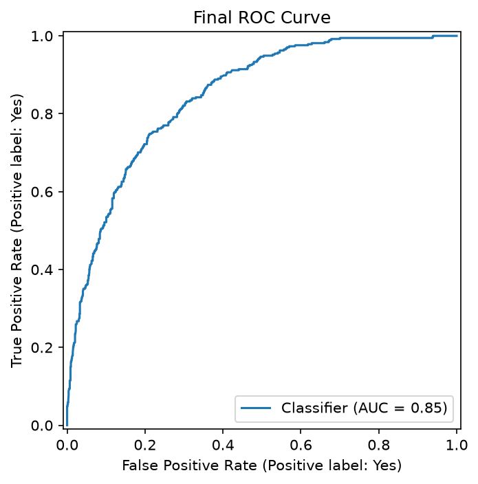
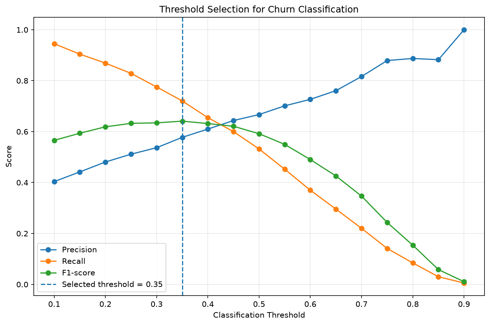
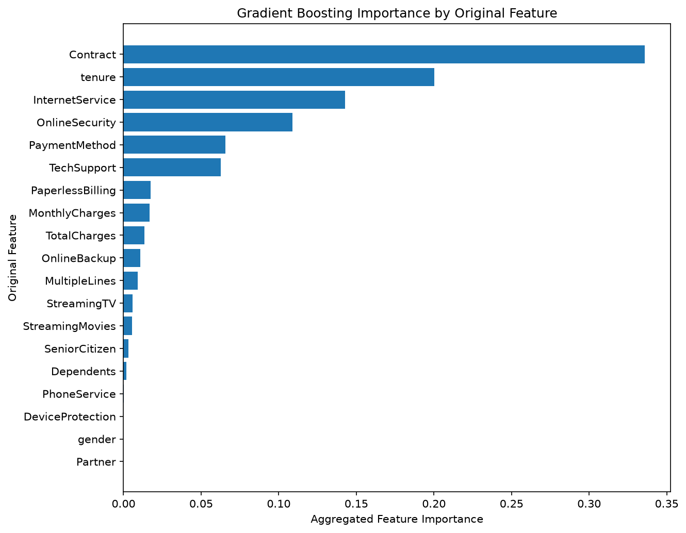

# Customer Churn Prediction

End-to-end machine learning project for predicting customer churn in a telecommunications company.

The project covers the complete machine learning lifecycle, from data understanding and exploratory analysis to model comparison, hyperparameter tuning, threshold selection, final evaluation, model interpretation, error analysis and reusable ML code.

## Key Results

| Metric | Final Test Result |
|---|---:|
| ROC-AUC | **0.8467** |
| Recall | **0.7219** |
| Precision | 0.5602 |
| F1-score | **0.6308** |
| Average Precision | 0.6675 |

- **Final model:** Gradient Boosting
- **Classification threshold:** `0.35`
- **Detected churners:** `270 / 374`

The selected operating threshold prioritizes churn detection over raw accuracy, increasing recall from approximately `51.3%` at the conventional `0.50` threshold to `72.2%`.




## Business Problem

Customer churn occurs when customers stop using a company's services.

The objective of this project is to estimate which customers are at higher risk of churn so that a telecommunications company could prioritize retention actions toward customers most likely to leave.

The problem is formulated as binary classification:

- `Churn = Yes` — the customer left the company.
- `Churn = No` — the customer remained with the company.

Because missing a potential churner can be particularly relevant in a retention context, the project considers recall, precision, F1-score and ranking metrics rather than relying exclusively on accuracy.

---

## Dataset

The project uses the **IBM Telco Customer Churn** dataset.

It contains:

- **7,043 customers**
- **21 original variables**
- demographic information;
- subscribed services;
- contract information;
- billing and payment information;
- customer tenure;
- churn status.

The target distribution is moderately imbalanced:

- approximately **73.5% non-churn**
- approximately **26.5% churn**

The raw dataset is intentionally excluded from Git version control.

Dataset acquisition and placement instructions are available in:

[`data/README.md`](data/README.md)

---

## Repository Structure

```text
customer-churn-ml/
│
├── data/
│   ├── raw/
│   ├── processed/
│   └── README.md
│
├── notebooks/
│   ├── 01_data_understanding.ipynb
│   ├── 02_eda.ipynb
│   ├── 03_preprocessing_baseline.ipynb
│   ├── 04_model_comparison.ipynb
│   ├── 05_hyperparameter_tuning.ipynb
│   ├── 06_threshold_analysis.ipynb
│   ├── 07_final_evaluation.ipynb
│   ├── 08_model_interpretation.ipynb
│   └── 09_error_analysis.ipynb
│
├── reports/
│
├── src/
│   ├── __init__.py
│   ├── config.py
│   ├── data.py
│   └── modeling.py
│
├── README.md
├── requirements.txt
└── .gitignore
```

---

## Machine Learning Workflow

### 1. Data Understanding

The initial dataset assessment focused on schema, variable roles and data quality.

Main findings:

- each row represents a unique customer;
- `customerID` is a unique identifier and is excluded from predictive modeling;
- `TotalCharges` is stored as an object despite representing a numerical quantity;
- 11 blank values were identified in `TotalCharges`;
- these records correspond to customers with `tenure = 0`;
- `SeniorCitizen` is numerically encoded but semantically categorical;
- no completely duplicated customer records were identified;
- the target exhibits moderate class imbalance.

Notebook:

[`01_data_understanding.ipynb`](notebooks/01_data_understanding.ipynb)

### 2. Exploratory Data Analysis

Exploratory analysis was used to identify customer characteristics associated with churn and generate hypotheses for modeling.

The strongest observed associations included:

- month-to-month contracts;
- shorter customer tenure;
- fiber-optic internet service;
- electronic-check payments;
- absence of online security;
- absence of technical support;
- higher monthly charges.

Customers with short tenure and month-to-month contracts form a particularly high-risk segment.

These findings describe associations in the dataset and should not be interpreted as causal relationships.

Notebook:

[`02_eda.ipynb`](notebooks/02_eda.ipynb)

### 3. Preprocessing and Baselines

The modeling workflow uses a scikit-learn `Pipeline` and `ColumnTransformer`.

Numerical features:

- `tenure`
- `MonthlyCharges`
- `TotalCharges`

Numerical preprocessing:

- median imputation;
- standardization using `StandardScaler`.

Categorical preprocessing:

- most-frequent-value imputation;
- one-hot encoding;
- support for previously unseen categories.

Preprocessing is fitted exclusively using training data to reduce the risk of data leakage.

The dataset is divided using a reproducible stratified 80/20 train/test split:

```text
Training set: 5,634 customers
Test set:     1,409 customers
```

A `DummyClassifier` establishes a majority-class reference baseline.

Although this classifier achieves relatively high accuracy because of target imbalance, it completely fails to identify churners.

Logistic Regression is then used as the first meaningful machine learning baseline.

Notebook:

[`03_preprocessing_baseline.ipynb`](notebooks/03_preprocessing_baseline.ipynb)

---

## Model Comparison

Candidate models were compared using stratified 5-fold cross-validation on the training set.

| Model | Mean CV ROC-AUC |
|---|---:|
| Logistic Regression | 0.8461 |
| Decision Tree | 0.6559 |
| Random Forest | 0.8200 |
| Gradient Boosting | **0.8478** |

Train-validation behavior was also inspected.

The Decision Tree showed severe overfitting:

```text
Train ROC-AUC:      1.0000
Validation ROC-AUC: 0.6559
Gap:                0.3441
```

Random Forest also showed a substantial train-validation gap.

By contrast:

```text
Logistic Regression gap: 0.0034
Gradient Boosting gap:    0.0400
```

Logistic Regression demonstrated particularly stable generalization, while Gradient Boosting achieved the strongest validation ROC-AUC.

Both models were therefore selected for hyperparameter tuning.

Notebook:

[`04_model_comparison.ipynb`](notebooks/04_model_comparison.ipynb)

---

## Hyperparameter Tuning

Logistic Regression and Gradient Boosting were tuned using `GridSearchCV` with ROC-AUC as the optimization metric.

The best Logistic Regression configuration achieved approximately:

```text
CV ROC-AUC: 0.8463
```

This represented only a negligible improvement over the untuned model.

Gradient Boosting achieved stronger validation performance.

The final configuration was:

```python
GradientBoostingClassifier(
    n_estimators=300,
    learning_rate=0.1,
    max_depth=1,
    min_samples_leaf=1,
    random_state=42,
)
```

Best cross-validation ROC-AUC:

```text
0.8509
```

Expanding the search beyond the initial parameter grid produced only a marginal improvement, so tuning was stopped to reduce the risk of overfitting the validation process.

Gradient Boosting was selected as the final predictive model.

Notebook:

[`05_hyperparameter_tuning.ipynb`](notebooks/05_hyperparameter_tuning.ipynb)

---

## Classification Threshold

The default classification threshold of `0.50` is not necessarily optimal for a churn-retention scenario.

Out-of-fold probabilities from the training data were therefore generated using stratified cross-validation.

Multiple thresholds between `0.10` and `0.90` were evaluated using:

- precision;
- recall;
- F1-score;
- accuracy;
- false positives;
- false negatives.

The selected operating threshold was:

```text
0.35
```

At this threshold, the out-of-fold training predictions achieved:

| Metric | Result |
|---|---:|
| Accuracy | 0.7859 |
| Precision | 0.5775 |
| Recall | 0.7204 |
| F1-score | **0.6411** |

The threshold increases the proportion of churners detected compared with the conventional `0.50` decision boundary.

No artificial monetary cost function was introduced because real retention-intervention and customer-loss costs were not available.

The threshold was fixed before final test-set evaluation.

Notebook:

[`06_threshold_analysis.ipynb`](notebooks/06_threshold_analysis.ipynb)

---

## Final Model Performance

After model architecture, hyperparameters and classification threshold were finalized, the model was evaluated on the held-out test set.

| Metric | Test Result |
|---|---:|
| Accuracy | 0.7757 |
| Precision | 0.5602 |
| Recall | **0.7219** |
| F1-score | **0.6308** |
| ROC-AUC | **0.8467** |
| Average Precision | 0.6675 |

Final confusion matrix:

```text
                 Predicted No   Predicted Yes
Actual No              823             212
Actual Yes             104             270
```

Out of 374 actual churners in the test set:

```text
Detected churners: 270
Missed churners:   104
```

The model therefore identifies approximately **72.2% of actual churners**.

The final test ROC-AUC of `0.8467` is also very close to the tuned cross-validation ROC-AUC of `0.8509`, indicating consistent generalization.

### Threshold Trade-off

For comparison:

| Threshold | Accuracy | Precision | Recall | F1 |
|---|---:|---:|---:|---:|
| 0.35 | 0.7757 | 0.5602 | **0.7219** | **0.6308** |
| 0.50 | 0.8020 | 0.6644 | 0.5134 | 0.5792 |

The selected `0.35` threshold sacrifices some accuracy and precision in exchange for substantially higher churn recall.

Notebook:

[`07_final_evaluation.ipynb`](notebooks/07_final_evaluation.ipynb)

The selected threshold was determined using out-of-fold training probabilities, not the final test set.



## Model Interpretation

The finalized Gradient Boosting model was analyzed using several complementary interpretation methods.


### Model-Based Feature Importance

After aggregating one-hot encoded categories back to their original variables, the strongest model-based predictors were:

| Feature | Importance |
|---|---:|
| Contract | 0.3357 |
| tenure | 0.2004 |
| InternetService | 0.1427 |
| OnlineSecurity | 0.1090 |
| PaymentMethod | 0.0658 |
| TechSupport | 0.0626 |

Strong individual encoded signals included:

- month-to-month contracts;
- fiber-optic internet;
- no online security;
- electronic-check payments;
- no technical support.

### Permutation Importance

Permutation importance using ROC-AUC identified `tenure` and `Contract` as the variables providing the strongest unique predictive contribution.

Top results included:

| Feature | Mean ROC-AUC decrease |
|---|---:|
| tenure | 0.0633 |
| Contract | 0.0386 |
| InternetService | 0.0146 |
| TotalCharges | 0.0058 |
| MonthlyCharges | 0.0046 |
| OnlineSecurity | 0.0044 |

Differences between model-based and permutation importance are expected because correlated or redundant variables can share predictive information.

### Partial Dependence

Partial dependence analysis showed that:

- predicted churn risk decreases substantially as customer tenure increases;
- predicted churn risk generally increases as monthly charges increase.

The step-like shape of the partial dependence curves is consistent with the final Gradient Boosting model being composed of shallow decision trees.

These interpretation results are broadly consistent with the original exploratory analysis.

However, they should be interpreted as **predictive associations rather than causal effects**.

Notebook:

[`08_model_interpretation.ipynb`](notebooks/08_model_interpretation.ipynb)

---

## Error Analysis

The final model produced:

```text
True Negatives:  823
True Positives:  270
False Positives: 212
False Negatives: 104
```

The analysis revealed systematic failure patterns.

### Short-Tenure Customers

The model is effective at detecting churn among recently acquired customers.

However, these customers also produce many false-positive alerts because short tenure is strongly associated with churn.

### Long-Tenure Customers

Customers with long tenure are usually correctly classified as non-churners.

However, when an established customer actually churns, the model is considerably more likely to miss them.

### Contract Type

Month-to-month customers are frequently identified as churn risks.

This produces strong churn detection but also more false positives.

Customers with one-year or two-year contracts are rarely classified as churners.

As a result, the relatively small number of long-contract customers who do churn can be difficult for the model to identify.

### Internet Service

Fiber-optic customers are frequently associated with churn and are therefore detected relatively well.

Customers without internet service are rarely predicted as churners, creating another potential blind spot.

### Prediction Confidence

Importantly, prediction errors are not limited to observations immediately around the `0.35` classification threshold.

Average churn probabilities were approximately:

```text
True Negative:  ~0.10
False Negative: ~0.20
False Positive: ~0.52
True Positive:  ~0.61
```

This indicates that some incorrect predictions occur with substantial model confidence.

The model therefore performs best when customers follow the dominant relationships observed during training and can struggle with atypical customers who contradict those patterns.

Segment-level error percentages should be interpreted cautiously when subgroup sample sizes are small.

Notebook:

[`09_error_analysis.ipynb`](notebooks/09_error_analysis.ipynb)

---

## Reusable ML Pipeline

Stable modeling logic was extracted from the analytical notebooks into reusable Python modules under `src/`.

### `src/config.py`

Contains project-wide configuration including:

- dataset filename;
- target column;
- identifier column;
- numerical features;
- train/test configuration;
- random seed;
- final classification threshold;
- final model hyperparameters.

### `src/data.py`

Provides reusable functions for:

- loading the dataset;
- converting `TotalCharges` to a numerical type;
- separating predictive features and target;
- creating the reproducible stratified train/test split.

### `src/modeling.py`

Provides reusable functions for:

- building the preprocessing workflow;
- building the finalized Gradient Boosting pipeline;
- generating positive-class probabilities;
- applying the final classification threshold.

The refactored pipeline was smoke-tested independently from the notebooks and reproduced the final held-out results:

```text
Accuracy:  0.7757
Precision: 0.5602
Recall:    0.7219
F1:        0.6308
ROC-AUC:   0.8467
```

---

## Evaluation Methodology

Several safeguards were used to reduce optimistic evaluation and data leakage.

- The train/test split is stratified and reproducible.
- The fixed test split was used for early baseline sanity checks.
- All subsequent model comparison, hyperparameter tuning and threshold selection were performed exclusively on the training data.
- The final test evaluation was not used to modify the finalized model or threshold.
- Missing-value imputation, scaling and encoding are contained inside scikit-learn pipelines.
- Candidate models use identical preprocessing.
- Model comparison uses stratified 5-fold cross-validation.
- Train-validation performance gaps are inspected for overfitting.
- Hyperparameter tuning uses only the training data.
- Threshold selection uses out-of-fold training probabilities.
- The final threshold is fixed before test evaluation.
- Model interpretation and error analysis performed on test data are post-hoc diagnostic stages and are not used to retune the model.

Primary evaluation metrics include:

- ROC-AUC;
- recall;
- precision;
- F1-score;
- average precision;
- confusion matrix analysis.

Accuracy is treated as a secondary metric because of target imbalance.

---

## Limitations

This project has several important limitations.

- The dataset is relatively small.
- The data represents a static historical snapshot.
- No temporal validation is available.
- Real customer-retention intervention costs are unavailable.
- The selected classification threshold is therefore metric-based rather than business-cost-optimal.
- Feature importance and partial dependence describe predictive relationships rather than causal effects.
- Several variables contain overlapping predictive information.
- Some customer subgroups contain relatively few churn observations.
- The dataset may not represent the customer population of a current telecommunications company.
- No production deployment, monitoring or data-drift system is included.

The model should therefore be validated on current, company-specific data before operational use.

---

## Reproducibility

Clone the repository and create a Python virtual environment.
The project was validated using **Python 3.13**.

Install the required dependencies:

```bash
pip install -r requirements.txt
```

Download the dataset following the instructions in:

[`data/README.md`](data/README.md)

Place the CSV at:

```text
data/raw/WA_FnUseC_TelcoCustomerChurn.csv
```

The analytical notebooks should then be executed sequentially:

```text
01_data_understanding.ipynb
02_eda.ipynb
03_preprocessing_baseline.ipynb
04_model_comparison.ipynb
05_hyperparameter_tuning.ipynb
06_threshold_analysis.ipynb
07_final_evaluation.ipynb
08_model_interpretation.ipynb
09_error_analysis.ipynb
```

The reusable implementation of the finalized workflow is available under:

```text
src/
```

---

## Technologies

- Python
- pandas
- NumPy
- Matplotlib
- scikit-learn
- Jupyter
- Git
- GitHub

---

## License

The project code is released under the MIT License.

The external dataset is not redistributed by this repository and remains subject to its original source terms.

---
## Project Status

**Completed**

The repository contains the complete development, validation, evaluation, interpretation and error-analysis workflow for the customer churn prediction system.